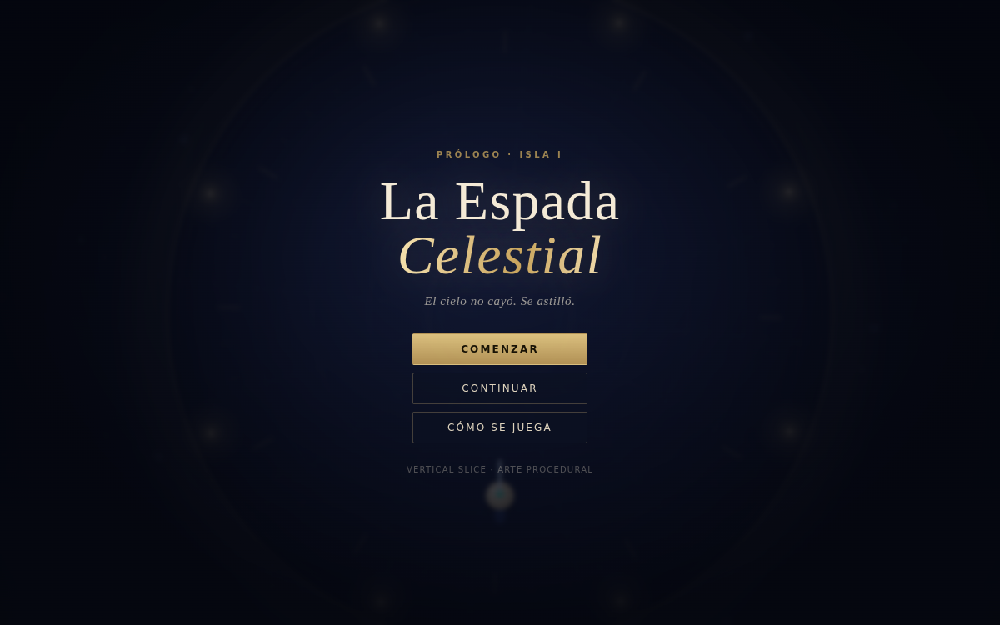

# PlayGround

## La Espada Celestial — vertical slice

RPG de acción cenital. Este repositorio contiene el **prólogo jugable** (Isla I), en HTML5 + Canvas, sin dependencias ni assets externos.



### Ejecutar

```
python3 -m http.server 3002
```

Abrir `http://localhost:3002/`. En móvil añadir `?touch=1` para forzar los controles táctiles (se detectan solos con puntero grueso).

### Controles

| Acción | Teclado | Táctil |
|---|---|---|
| Mover | WASD / flechas | Joystick |
| Corte | J / Espacio | Botón **Corte** |
| Corte Celestial (gasta Qi) | K | Botón **Corte Celestial** |
| Esquiva (invulnerable) | Shift | Botón **Esquiva** |
| Pausa | Esc / P | Botón II |

### Contenido

- Tres oleadas de enemigos (Sombra Errante, Guardián de Jade, Espectro).
- Jefe **Centinela del Cielo Roto** con tres fases, invocaciones y ondas expansivas.
- Nivel, XP, Qi, guardado en `localStorage`, pausa y ajuste de dificultad por oleada.
- Diálogo con máquina de escribir, HUD, daño flotante, partículas y sacudida de cámara.

### Documentación

- [`docs/DISENO-LA-ESPADA-CELESTIAL.md`](docs/DISENO-LA-ESPADA-CELESTIAL.md) — diseño completo, portable a cualquier motor o herramienta.
- [`docs/VERIFICACION.md`](docs/VERIFICACION.md) — qué se ejecutó, qué falló y qué **no** está verificado.
- [`docs/capturas/`](docs/capturas/) — capturas del build actual.

### Depuración

Añadir `?debug=1`: `B` invoca al jefe, `V` vacía la oleada, `H` cura.

> El arte es procedural y el juego se ha probado en Chromium (escritorio y viewport móvil). No se ha probado en un Android real ni dentro de AI Game Maker.

<!-- omgithub:readme:start -->
## 🚀 Build, play, and remix with OMGithub

**Created using [OMGithub.com](https://omgithub.com).**

[](https://omgithub.com/hamburguesakingchikeng-cloud/PlayGround)
[](https://github.com/hamburguesakingchikeng-cloud/PlayGround)

- 🎮 [Open the project](https://omgithub.com/hamburguesakingchikeng-cloud/PlayGround).
- ✨ [Remix this project](https://omgithub.com/?remix=hamburguesakingchikeng-cloud%2FPlayGround).
- 💻 [Explore the source](https://github.com/hamburguesakingchikeng-cloud/PlayGround).
- 🛠️ [Check build runs](https://github.com/hamburguesakingchikeng-cloud/PlayGround/actions).
- 🐛 [Report an issue](https://github.com/hamburguesakingchikeng-cloud/PlayGround/issues).
- 👤 [Explore the creator's projects](https://omgithub.com/hamburguesakingchikeng-cloud).
- 🌍 [Create with OMGithub](https://omgithub.com).
<!-- omgithub:readme:end -->
